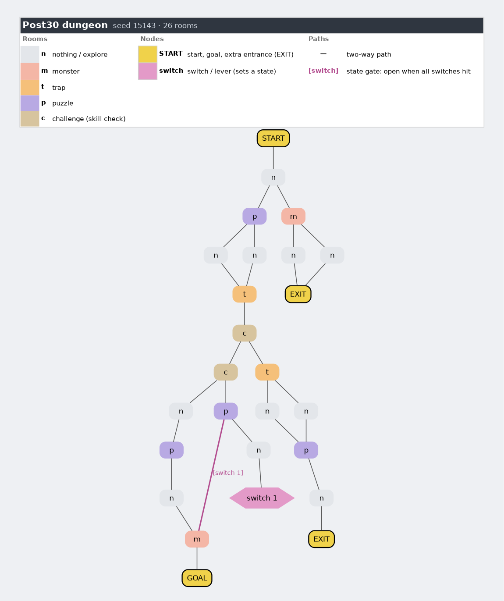
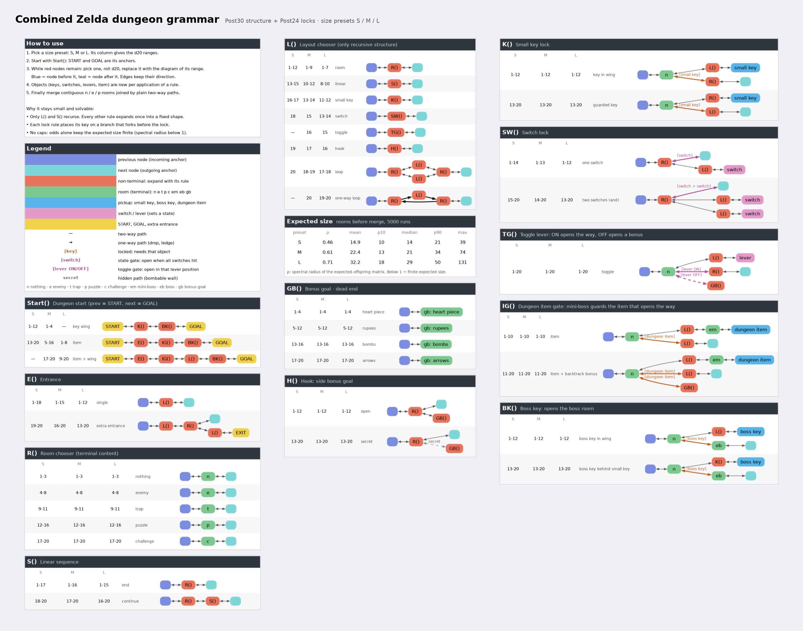

# Dungeon Generator

**version:** 2.0.0

**date:** 2026-10-25

based on the grammar defined by [fantomx11](https://forum.rpg.net/index.php?members/fantomx11.74669/) in the [RPG.net forum](https://forum.rpg.net/index.php?threads/necro-my-zelda-dungeon-generator.827119/)

## Install

Use [uv](https://docs.astral.sh/uv/) for creating the virtual environment with

```bash
$ uv sync
```

## Usage

Launch the CLI script

```bash
$ uv run python dungeon_generator_cli.py
```

```bash
usage: dungeon_generator_cli.py [-h] [--combined | --post24 | --post30]
                                [--size {S,M,L}] [--theme {cyber,tor-barrow,tor-dwarf,zelda}]
                                [--seed SEED] [--maxnodes MAXNODES]
                                [--maxiter MAXITER] [--show-graph]
                                [--output OUTPUT] [--json JSON] [--key KEY]
                                [--no-reduce] [--debug]

options:
  -h, --help            show this help message and exit
  --combined            Generate a Dungeon using the Combined Grammar
                        (grammar/combined.py). Default
  --post24              Generate a Dungeon using the Post24 Grammar (legacy,
                        may be unsolvable)
  --post30              Generate a Dungeon using the Post30 Grammar (legacy,
                        may be unsolvable)
  --size {S,M,L}        Size preset for the Combined Grammar (case
                        insensitive)
  --theme {cyber,tor-barrow,tor-dwarf,zelda}
                        Room labels, object names and rewards for the Combined
                        Grammar (grammar/themes.py)
  --seed SEED           Seed for the dungeon
  --maxnodes MAXNODES   Maximum number of nodes to include
  --maxiter MAXITER     Maximum number of iterations to perform
  --show-graph          Shows graph on generation
  --output OUTPUT       Saves the graph to a file (.png, .svg or .pdf)
  --json JSON           Saves the graph as JSON (rooms, gates, objects)
  --key KEY             Saves the GM key as Markdown (rooms, exits, keys)
  --no-reduce           Does not merge adjacent rooms of the same type (n, e,
                        t, p, c)
  --debug               Debug information
```

The Combined grammar is the default. Post24 and Post30 are kept as legacy: both grow without
bound and can drop the key of a lock, so their dungeons may be unsolvable.

### Examples

Running the command

```bash
$ uv run python dungeon_generator_cli.py --post30 --seed 15143 --output dungeon.png
```

will save this graph (Graphviz is required). Rooms flow from START (top) to GOAL (bottom),
locks and gates are drawn as labelled paths and the legend lists the elements present.



Generate a medium sized dungeon with the Combined grammar (default)

```bash
$ uv run python dungeon_generator_cli.py --size M --seed 15143 --show-graph
```

Export the graph as JSON, the base for other tools (e.g. a FoundryVTT module)

```bash
$ uv run python dungeon_generator_cli.py --seed 15143 --json dungeon.json
```

`nodes` holds every vertex: `kind` is `room` (with the `objects` found in it, its GM key
`number` and its themed `label`) or `gate` (`gate` is `lock`, `state`, `on`, `off` or `secret`,
and `requires` lists the objects it needs). `schema_version` is 2 (1 had no `number`/`label`).
`edges` are two-way unless `oneway`. Each entry of `objects` lists the rooms where it is
found (`found_in`) and the gates it `opens`. `solvable` and `unsolvable_reasons` come from the
solvability check. Legacy grammars export their locks as plain rooms.

Write a GM key in Markdown to run the dungeon at the table

```bash
$ uv run python dungeon_generator_cli.py --seed 15143 --key dungeon.md
```

Rooms are numbered from START, each with its contents and exits. Gates are not numbered: they
show up on the exits that cross them (`locked: small key 1`, `needs switch 2`, `lever 1 ON`,
`secret`, `one-way`). The keys table lists where each object is found and which doors
(`3 ↔ 6`, or `27 → 26` when one-way) it opens.

Pick a theme for the room labels, object names and bonus goal rewards of the Combined grammar

```bash
$ uv run python dungeon_generator_cli.py --seed 444 --theme cyber --key dungeon.md
```

Themes are data in `grammar/themes.py` (`zelda` is the default, `cyber` is a netrunning dungeon:
ICE, access codes, relays, a core AI;
`tor-barrow` and `tor-dwarf` are The One Ring sites: a barrow of restless dead and a barrow-wight
lord, a dwarf-hold of orcs, ithildin seals and a cave-troll). A theme only changes text, so the same seed gives the same
layout with any theme. Add a theme with its `rooms` descriptions, `objects` names and a d20
`rewards` table covering 1-20.

### From generated dungeon to table-ready site

How Fram's Howe (La Caza del Ojo Rojo, 2950) and the Barrow of Aranarth (Echoes of Destiny,
2965) were made. The generator gives the structure; the flavouring (done with Claude Code) gives
the site.

1. **Generate** the map, the JSON and the GM key with the same seed and theme

   ```bash
   $ uv run python dungeon_generator_cli.py --size L --seed 444 --theme tor-barrow \
       --output ruin.png --json ruin.json --key ruin.md
   ```

   Check that the key says `solvable`. Reroll the seed if the layout does not fit the site.

2. **Brief the site** in a few lines: where it is, who is buried or lived there, the campaign
   and the year. E.g. *"Use ruin.json, ruin.md, ruin.png for flavouring a Barrow: the Barrow
   of Aranarth, the Angle of the Dúnedain, a group of Rangers of the North, 2965"*.

3. **Check canon** in the notes (`qmd query "..."`) before writing. When canon clashes with
   the generated rooms, bend the story, not the layout. E.g. Aranarth was buried without
   treasure, so the grave-goods and the barrow-wight lord belong to an older traitor's tomb
   under his mound.

4. **Write `ruin-<site>.md`**, using `ruin-fram-howe.md` as the model:
   - **Overview**: Where, Who lies here, What went wrong, Why now (the campaign year), Hooks
     (pick one), Map (`![[ruin.png]]`).
   - **How it works**: the themed name of every lock, switch and one-way loop.
   - **Suggested mechanics**: tests and losses for the room types (`ENDURANCE`, `EXPLORE`,
     `SCAN`, `Shadow: Greed`).
   - **Rooms**: same numbers and exits as `ruin.md`. Short read-aloud boxes, bold key elements,
     `[Landmark]`/`[Hidden]`/`[Secret]` tags, one riddle handout (with answer) per rhyming
     portal, adversaries embedded from `eau_adversaries`.
   - **Keys and gates**: the `ruin.md` table, each object as `Themed name (generated name)`.

   Keep the layout intact: never change room numbers, exits, gates or one-way paths. Invented
   NPCs must not reuse canon names.

5. **Move it to the campaign vault** (`1-worlds/101-campaigns/<campaign>/`):
   - note to `20-locations/<region>/<site>.md`, with the vault frontmatter (`title`, `summary`,
     `type: place`, `Campaign`, tags with the campaign prefix);
   - map to `99-imgs/<site>-map.png`, and update the embed;
   - delete `ruin-<site>.md` and `ruin.png` from the repo (`ruin.json` and `ruin.md` can be
     regenerated from the seed).

### Legend

#### Post24 (legacy)

**GOAL:** Dungeon Goal

**START:** Initial position

**e:** Enemy

**eb:** Main Boss

**em:** Mini Boss

**external:** Object from outside the Dungeon

**n:** Nothing/Explore

**p:** Puzzle

**sw:** Switch (Lever, etc)

#### Post30 (legacy)

**EXIT:** Another Entrance/Exit

**GOAL:** Dungeon Goal

**START:** Initial position

**c:** Challenge (Skill check)

**gb:** Bonus goal

**m:** Monster

**n:** Nothing/Explore

**p:** Puzzle

**t:** Trap

#### Combined

Merges both grammars (`grammar/combined.py`): Post30 structure (layouts, loops, one-way paths,
secret paths, extra entrances) with Post24 locks (small keys, boss key, dungeon item behind a
mini-boss, switches, toggle levers, bonus goals). Every lock's key is placed on a branch that forks
before the lock, so every dungeon is solvable.

Room content is paced: the R rooms are filled once the layout is final, with d20 ranges that
depend on how far the room is between START and the boss (`PACING` in `grammar/combined.py`).
Early rooms are mostly empty, enemies and puzzles; traps and challenges cluster near the end
and within two steps of the mini-boss and the boss.

Adjacent rooms of the same type (n, e, t, p, c) joined by a two-way path are merged into one
room that keeps all their exits (`--no-reduce` skips this). Rooms joined by a one-way path are
not merged, so one-way paths are kept.

**Rooms**

**START:** Initial position

**GOAL:** Dungeon Goal

**EXIT:** Another Entrance/Exit

**n:** Nothing/Explore

**e:** Enemy

**t:** Trap

**p:** Puzzle

**c:** Challenge (Skill check)

**em:** Mini Boss

**eb:** Main Boss

**gb:** Bonus goal

**Pickups and switches**

**key:** Small key

**bosskey:** Boss key

**item:** Dungeon item

**switch:** Switch (all must be hit to open a state gate)

**lever:** Toggle lever (ON / OFF)

**Gates**

**lock:** Locked door, needs the named object

**gate:** State or toggle gate, needs the switches or the lever position

**s:** Secret path (bombable wall)

**Size presets** (`--size`), approximate number of nodes over 2000 runs

| Preset | p10 | median | p90 |
|--------|-----|--------|-----|
| S      | 10  | 14     | 20  |
| M      | 13  | 20     | 34  |
| L      | 18  | 30     | 51  |

The full grammar sheet can be rendered with Graphviz

```bash
$ uv run python -m grammar.render --output refs/combined.png
```



## Relations

A simple analisis of the grammar elements relations can be found in the folder `refs/relations`

### Usage

```bash
$ uv run python refs/relations/rel24.py
```

## Changelog

* Unreleased: `--theme` (themes as data in `grammar/themes.py`, `cyber` theme); the
  `cyberpuzze.py` stub and `cyber_generator_cli.py` are removed
* v2.0.0 Combined grammar (default, solvable by construction; Post24 and Post30 kept as legacy),
  solvability check, `--json` export, `--key` GM key, room pacing by progress, merge of t and c
  rooms keeping one-way paths. Independent seeded rolls replace the dice pool, so a seed gives a
  different dungeon than in v1
* v1.0.1 Refill dice pool when it runs out (pool removed in v2.0.0)
* v1.0 Initial release
